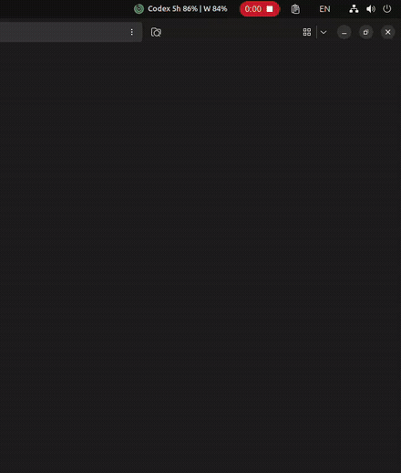

# remaining

English | [한국어](README.ko.md)

AI quota usage from the terminal and the GNOME top bar.


## What it does

`remaining` reads usage windows and reset times from supported providers and shows them as:

- a terminal summary;
- JSON for scripts and desktop integrations;
- an optional GNOME Shell panel popup.

## Providers

| Provider | Data source | Usage details |
| --- | --- | --- |
| Codex | ChatGPT OAuth usage API | 5-hour, weekly, model limits, reset credits |
| Z.ai | Z.ai quota API | 5-hour, weekly, monthly tools |
| Ollama Cloud | Ollama web session | 5-hour or hourly session, weekly |
| OpenCode Go | Workspace API or local history | estimated session, weekly, monthly |
| MiniMax | Token/Coding Plan API | 5-hour, weekly |

Codex, Z.ai, and Ollama Cloud are enabled by default. A provider without valid credentials is reported as `auth_required`; selecting a provider does not imply that you have an active subscription.

## Quick start

Requirements:

- Rust 1.86 or newer;
- Ubuntu 24.04 with GNOME Shell 46 for the included extension;
- `gnome-extensions`, `gsettings`, and `glib-compile-schemas` for extension installation.

Install the CLI:

```sh
git clone https://github.com/jsut21/remaining.git
cd remaining
cargo install --locked --path .
remaining
```

Install the GNOME extension after installing the CLI:

```sh
./desktop/gnome/install.sh
```

Log out and back in after installation or an upgrade so GNOME loads the new extension code. Remove the extension with:

```sh
./desktop/gnome/uninstall.sh
```

The CLI is not removed. Add `--purge-settings` to remove saved GNOME settings as well.

## GNOME

The included GNOME Shell extension is the desktop integration for Ubuntu 24.04 and GNOME Shell 46.

<p align="center">
  
</p>

<p align="center">
  <a href="docs/media/remaining-gnome-demo.mp4">Open the original MP4 demo</a>
</p>

## CLI

```sh
remaining
remaining --json
remaining --json --pretty
remaining --provider codex,zai,ollama
remaining --all
remaining --list-providers
remaining --watch 300
```

Supported browser-cookie access is enabled for selected providers by default. Disable it explicitly:

```sh
remaining --no-browser-cookies
```

Custom provider endpoints are restricted to official HTTPS domains by default. Only enable custom endpoints when you trust the destination:

```sh
remaining --provider zai --allow-custom-endpoints
```

Run `remaining --help` for all options.

## Data and privacy

- Only selected providers are queried.
- Browser-cookie access is limited to supported provider domains and can be disabled with `--no-browser-cookies`.
- Provider environment variables and local credential files may be read when needed.
- Credentials are not included in terminal or JSON output.
- Plain HTTP and URLs containing embedded credentials are rejected.
- Unknown usage is returned as `null`, never as a made-up 100% remaining value.

See [provider details](docs/providers.md) before enabling additional providers. Do not include authentication files or unredacted output in bug reports.

## JSON

Every provider result uses `schema_version: 2`. Unknown quota values use:

```json
{
  "remaining_percent": null,
  "used_percent": null,
  "usage_known": false
}
```

Consumers should not display unknown usage as 100% remaining. The full schema is [schemas/remaining.schema.json](schemas/remaining.schema.json).

## Status

This is an early Linux/GNOME-focused project. Provider APIs and response formats can change without notice, so values are best effort and may differ temporarily from a provider dashboard.

The project is unofficial and is not affiliated with OpenAI, Z.ai, Ollama, OpenCode, or MiniMax.

More implementation notes are in [docs](docs/).

## License

MIT. See [LICENSE](LICENSE).
